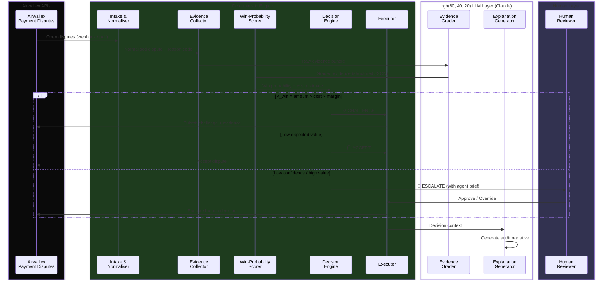

<div align="center">

# 🛡️ DisputeIQ

### **Hybrid AI Agent for Intelligent Payment Dispute Resolution**

> **DisputeIQ pairs an LLM's evidence-reading intelligence with a deterministic decision engine's financial discipline** — so every chargeback gets the right response: challenged with precision, accepted with reason, or escalated with context.

<br/>

[](https://www.airwallex.com)
[](https://www.airwallex.com/docs/api/payments/payment_disputes)
[](#-implementation-plan)

<br/>


---

[The Problem](#-the-problem) · [The Solution](#-the-solution) · [How It Works](#-how-it-works) · [Decision Engine](#-decision-engine) · [Architecture](#-architecture) · [Airwallex APIs](#-airwallex-apis-used) · [Implementation Plan](#-implementation-plan) · [Quick Start](#-quick-start)

</div>

---

## 🔥 The Problem

Every merchant that accepts cards eventually meets the **chargeback**. Handling one well is surprisingly hard:

| Pain Point | Impact |
| :-- | :-- |
| ⏰ **Deadlines are strict** | Miss the response window → automatic loss |
| 🧾 **Evidence is scattered** | Across order systems, shipping records, support emails, access logs |
| 💸 **Not every dispute is worth fighting** | A \$12 chargeback can cost more to contest than to accept |
| 🎯 **Each reason needs different proof** | Wrong evidence = lost winnable cases |

> **The result:** Small and mid-sized teams either **accept everything** (leaving money on the table) or **fight everything** (wasting effort on losing cases). Neither strategy is rational.

---

## 💡 The Solution

**DisputeIQ** is an autonomous agent that runs the _entire_ dispute workflow — from intake to filed response — using a **hybrid architecture** where each component plays to its strengths:

| Step | What the Agent Does | Powered By |
| :-- | :-- | :-: |
| 📥 **Intake** | Pulls open disputes from Airwallex; reads reason, amount & deadline | `Deterministic` |
| 🔎 **Gather** | Collects evidence relevant to *that specific* dispute reason | `Deterministic` |
| 🧠 **Assess** | Grades each piece of evidence for strength and relevance | `LLM` |
| ⚖️ **Decide** | Weighs expected recovery against cost → **Accept · Challenge · Escalate** | `Deterministic` |
| 📤 **Act** | Files the response via Airwallex API, or hands off with a ready-made brief | `Deterministic` |
| 🧾 **Explain** | Records a plain-language reason and full audit trail | `LLM` |

<div align="center">

> **🔑 Design Principle**
>
> The LLM *reads, grades, and explains*. Deterministic code *scores, enforces policy, and moves money*.
> **The model never gets the final say on financial decisions.**

</div>

---

## ⚙️ How It Works

The following diagram traces a dispute from arrival to resolution. Note the explicit boundaries between the **LLM layer**, the **Deterministic Engine**, and the **Airwallex API** surface:



---

## 🧮 Decision Engine

Fighting a dispute is a bet. DisputeIQ treats it like one.

### The Expected Value Formula

The core decision rule is a straightforward expected-value calculation:

$$
EV_{\text{challenge}} = P_{\text{win}} \times \text{amount} - C_{\text{challenge}}
$$

A challenge is only worthwhile when:

$$
P_{\text{win}} \times \text{amount} \;>\; C_{\text{challenge}} \times M_{\text{safety}}
$$

Where:
- $P_{\text{win}}$ — win probability estimated from graded evidence strength (0.0–1.0)
- $\text{amount}$ — disputed transaction value
- $C_{\text{challenge}}$ — operational cost of preparing and filing the response
- $M_{\text{safety}}$ — configurable safety margin (default: 1.5×) to avoid marginal bets

### Decision Outcomes

| Outcome | Triggers |
| :-- | :-- |
| ✅ **CHALLENGE** | Evidence is strong, $EV_{\text{challenge}} > 0$ with confidence above policy threshold |
| 🏳️ **ACCEPT** | Expected recovery < cost, genuine merchant error (e.g. true duplicate), or required evidence unobtainable |
| 🚨 **ESCALATE** | Amount > auto-approval limit, confidence is low, evidence conflicts, fraud-pattern signals, or tight deadline with ambiguous case |

### Evidence Map

The required proof depends on the dispute reason. The agent only requests and weighs what is relevant:

| Dispute Reason | Evidence the Agent Looks For |
| :-- | :-- |
| **Product / service not received** | Order fulfilment proof, shipping / delivery records, customer communication |
| **Digital goods not used** | Product consumption records, account access activity logs |
| **Duplicate charge** | Duplicate payment details, transaction timestamps and amounts |
| **Fraud / unauthorised** | Authentication proof (3DS), previous purchases, prior dispute history |
| **Not as described** | Order snapshot, customer communication, business model description |

> All thresholds (`challenge_cost`, `safety_margin`, `auto_approve_limit`, `min_confidence`) live in a single **`policy.yaml`**, so a finance team can tune behaviour without touching code.

> [!NOTE]
> Win probabilities come from a transparent, evidence-weighted heuristic calibrated on labelled demo scenarios. They are **decision aids**, not claims about real-world win rates.

---

## 🏗️ Architecture

```
┌─────────────────────────────────────────────────────────────────────────┐
│                          Dashboard (UI)                                 │
│    dispute queue · agent reasoning · approve / override · audit log     │
└──────────────────────────────┬──────────────────────────────────────────┘
                               │ REST / WebSocket
┌──────────────────────────────▼──────────────────────────────────────────┐
│                        FastAPI Orchestrator                              │
│                                                                         │
│   Intake ──▶ Evidence ──▶ Grader ──▶ Scorer ──▶ Decision ──▶ Executor   │
│                           ╔══════╗   ╔══════╗   ╔════════╗              │
│                           ║ LLM  ║   ║Rules ║   ║ Policy ║              │
│                           ╚══════╝   ╚══════╝   ╚════════╝              │
└─────────┬───────────────────────┬──────────────────────┬────────────────┘
          │                       │                      │
┌─────────▼──────────┐  ┌────────▼──────────┐  ┌────────▼──────────┐
│  Airwallex Adapter  │  │   Claude API      │  │  SQLite Store     │
│                     │  │                   │  │                   │
│  • sandbox mode     │  │  • evidence       │  │  • decisions      │
│  • simulator mode   │  │    grading        │  │  • audit trail    │
│  • one interface    │  │  • explanations   │  │  • idempotency    │
└─────────────────────┘  └───────────────────┘  └───────────────────┘
```

**Sandbox first, simulator as a safety net.** The Airwallex adapter has two modes behind one interface:

| Mode | Behaviour |
| :-- | :-- |
| `MODE=sandbox` | Connects to the real Airwallex demo environment |
| `MODE=simulator` | Serves schema-faithful mock disputes locally — demo never depends on sandbox state |

### 🔐 Safety Guardrails

DisputeIQ enforces strict safety boundaries at every layer:

| Guardrail | How It Works |
| :-- | :-- |
| 👤 **Human-in-the-loop** | Mandatory approval above configured amount limit and for every escalation |
| 🙈 **PII redaction** | Card numbers, customer identifiers, and PII are **stripped before** any text reaches the LLM |
| 🧪 **Dry-run mode** | `DRY_RUN=true` previews every action without calling write endpoints — safe for demos and testing |
| 🔁 **Idempotency keys** | Each dispute can only be accepted or challenged once; duplicate submissions are blocked at the DB layer |
| 🧾 **Full audit trail** | Every decision records: inputs, evidence grades, score, policy version, reasoning, and final action |

---

## 🔌 Airwallex APIs Used

| Purpose | Endpoint | Method |
| :-- | :-- | :-: |
| Authenticate | `/api/v1/authentication/login` | `POST` |
| List open disputes | `/api/v1/pa/payment_disputes` | `GET` |
| Retrieve one dispute | `/api/v1/pa/payment_disputes/{id}` | `GET` |
| Accept a dispute | `/api/v1/pa/payment_disputes/{id}/accept` | `POST` |
| Challenge a dispute | `/api/v1/pa/payment_disputes/{id}/challenge` | `POST` |
| Upload evidence files | Airwallex Files API *(returns file IDs for challenge payload)* | `POST` |

The challenge request accepts structured evidence fields — order fulfilment, customer communication, product consumption, access activity file IDs — and DisputeIQ's evidence map is built around exactly these fields.

📖 **Docs:** <https://www.airwallex.com/docs/api/payments/payment_disputes>

---

## 🗺️ Implementation Plan

> **Build window: Oct 25 → Nov 13, 2026** · Solo build — scope is deliberately tight.

### 🟧 Phase 0 · Idea Phase <sup>`now → Oct 23`</sup>

- [x] Pick the track and define the agent's decision problem
- [x] Design the architecture, decision rule and evidence map
- [ ] Submit idea: README, video, slide deck (PDF) and demo

### 🟦 Phase 1 · Foundation <sup>`Oct 25 → Oct 31`</sup>

- [ ] Airwallex sandbox account, authentication and token handling
- [ ] Adapter with `sandbox` and `simulator` modes behind one interface
- [ ] Dispute intake, normalisation and SQLite storage
- [ ] Seed 8–10 labelled demo scenarios

### 🟩 Phase 2 · The Brain <sup>`Nov 1 → Nov 7`</sup>

- [ ] Evidence collector driven by the reason → evidence map
- [ ] Claude evidence grader with structured JSON output
- [ ] Deterministic win-probability scorer and `policy.yaml`
- [ ] Decision engine: Accept · Challenge · Escalate with written reasoning
- [ ] Executor wired to accept / challenge endpoints, with idempotency and dry-run

### 🟪 Phase 3 · Ship <sup>`Nov 8 → Nov 13`</sup>

- [ ] Dashboard: queue, reasoning view, human approve / override
- [ ] Backtest on scenarios vs. baselines (*always accept*, *always challenge*)
- [ ] Record demo video (under 5 min)
- [ ] README polish, setup instructions, final submission by **Nov 13**

### 🏁 Demo Day <sup>`Nov 19`</sup>

- [ ] Live walkthrough: one dispute from intake → filed response

---

## 🎬 Demo Scenarios

| # | Scenario | Dispute Reason | Amount | Expected Decision |
| :-: | :-- | :-- | --: | :-: |
| 1 | Signed delivery proof on file | Product not received | \$249 | ✅ Challenge |
| 2 | Access logs show active post-purchase usage | Digital goods not used | \$89 | ✅ Challenge |
| 3 | Subscription dispute, evidence cost > recovery | General | \$12 | 🏳️ Accept |
| 4 | True duplicate charge (merchant error) | Duplicate | \$150 | 🏳️ Accept |
| 5 | High-value fraud claim, thin / conflicting evidence | Fraud | \$2,400 | 🚨 Escalate |

---

## 📊 How Success Is Measured

| Metric | Target | Why It Matters |
| :-- | :-: | :-- |
| **Decision accuracy** | ≥ 90% | Agent reaches the correct outcome on labelled scenarios |
| **Net recovered value** | > baselines | Deciding with cost-awareness beats *always accept* and *always challenge* |
| **Escalation precision** | > 80% | Hands off the right cases without flooding the human queue |
| **Deadline safety** | 100% | Zero disputes lapsing to a default loss |

---

## 🧰 Tech Stack

| Layer | Choice | Role |
| :-- | :-- | :-- |
| **Backend** | Python 3.11 · FastAPI · Pydantic | Orchestration, validation, API layer |
| **LLM** | Claude Sonnet (Anthropic API) | Evidence grading, explanation generation |
| **Storage** | SQLite | Decisions, audit trail, idempotency keys |
| **Payments** | Airwallex Payment Disputes API | Dispute lifecycle (sandbox / simulator) |
| **Frontend** | Lightweight dashboard | Queue, reasoning view, human override |
| **Config** | `policy.yaml` · `.env` | Tunable thresholds, secrets, mode selection |

---

## 📁 Project Structure

```
disputeiq/
├── app/
│   ├── main.py                 # FastAPI entry point
│   ├── config.py               # env + policy loading
│   ├── airwallex/
│   │   ├── client.py           # auth, requests, retries
│   │   ├── disputes.py         # list / get / accept / challenge
│   │   └── simulator.py        # schema-faithful mock disputes
│   ├── agent/
│   │   ├── intake.py           # normalise & store incoming disputes
│   │   ├── evidence.py         # reason → required evidence mapping
│   │   ├── grader.py           # Claude evidence grading (LLM)
│   │   ├── scorer.py           # deterministic win probability
│   │   ├── decision.py         # accept / challenge / escalate logic
│   │   └── executor.py         # idempotent actions + dry-run
│   ├── policy/
│   │   └── policy.yaml         # all tunable thresholds
│   └── db/
│       └── audit.py            # SQLite models & queries
├── dashboard/                  # UI (queue, reasoning, overrides)
├── data/scenarios/             # labelled demo disputes (JSON)
├── tests/                      # unit + integration tests
├── .env.example                # template for env config
├── requirements.txt
└── README.md
```

---

## 🚀 Quick Start

> [!IMPORTANT]
> The repository is populated progressively between **Oct 25 and Nov 13**. These instructions are for the build phase and beyond.

### Prerequisites

| Requirement | Version |
| :-- | :-- |
| Python | 3.11+ |
| pip | Latest |
| Git | 2.x+ |
| Airwallex sandbox account | [Sign up →](https://www.airwallex.com) |
| Anthropic API key | [Get key →](https://console.anthropic.com) |

### 1. Clone & Install

```bash
# Clone the repository
git clone https://github.com/<your-username>/disputeiq.git
cd disputeiq

# Create virtual environment
python -m venv .venv

# Activate (pick your OS)
# Linux / macOS:
source .venv/bin/activate
# Windows (PowerShell):
.venv\Scripts\Activate.ps1

# Install dependencies
pip install -r requirements.txt
```

### 2. Configure Environment

```bash
cp .env.example .env
```

Edit `.env` with your credentials:

```ini
# ── Mode ─────────────────────────────────────────────────
MODE=simulator                  # simulator | sandbox

# ── Airwallex ────────────────────────────────────────────
AIRWALLEX_BASE_URL=https://api-demo.airwallex.com
AIRWALLEX_CLIENT_ID=your_client_id
AIRWALLEX_API_KEY=your_api_key

# ── LLM ──────────────────────────────────────────────────
ANTHROPIC_API_KEY=your_anthropic_key
ANTHROPIC_MODEL=claude-sonnet-5-5

# ── Safety ───────────────────────────────────────────────
DRY_RUN=true                    # true = preview-only, no writes
```

### 3. Run

```bash
# Start the API server
uvicorn app.main:app --reload

# In a new terminal — run demo scenarios
python -m app.agent.demo --scenarios data/scenarios
```

Open the dashboard at **[http://localhost:8000](http://localhost:8000)**.

---

## 🧭 Why DisputeIQ

| Principle | What It Means |
| :-- | :-- |
| **Real decisions, not chat** | The agent trades off money, evidence and time — the core of agentic banking |
| **Acts, within limits** | Moves from reading a dispute to filing a response, but only inside human-controlled policy |
| **Fully auditable** | Every action carries a reason, a score, and a policy version |
| **Hybrid by design** | LLM handles nuance (evidence reading); deterministic engine handles money (scoring, thresholds) |
| **Solo-build scoped** | Each phase ends in something demo-able |

---

## 🔮 Beyond the Hackathon

- 📈 **Outcome learning** — feed win/loss results back into the scorer to improve $P_{\text{win}}$ over time
- 🌐 **Per-network templates** — card-network-specific evidence templates and deadline rules
- 💬 **Slack approvals** — one-click escalation approval from Slack
- 🚨 **Dispute prevention** — flag orders likely to be disputed *before* the chargeback arrives

---

## 👤 Author

**Abhisekh Nayek**

---

## 📄 License

Released under the [MIT License](LICENSE).
You retain full ownership of your project; submission only grants the hackathon organisers permission to showcase it.

---

<div align="center">

<br/>

**Built for the [Airwallex Agentic Banking Hackathon 2026](https://www.airwallex.com)**

*Fight the disputes worth fighting. Let go of the rest.* 🛡️

<br/>

</div>